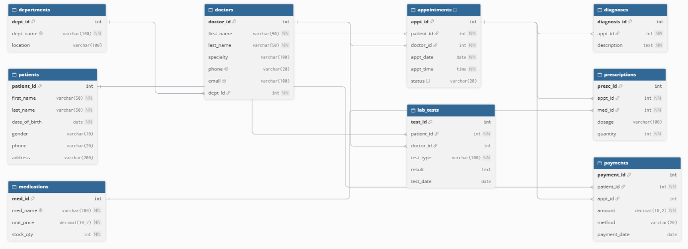

# Portfolio 1: Database Design and Modelling

## Case Study: CarePoint Specialist Hospital, Lagos (Simulated)

**Nature of the business:** CarePoint is a private hospital that provides
outpatient consultations, diagnosis, laboratory tests and pharmacy services.

**Users of the database:** Receptionists, doctors, nurses, lab scientists,
pharmacists, billing staff and administrators.

**Major data stored:** Patients, doctors, departments, appointments,
diagnoses, prescriptions, medications, laboratory tests and payments.

**Key operations:** Register patients, book appointments, record diagnoses,
issue prescriptions, record lab results, process payments and retrieve
patient history.

## ER Diagram

The ER diagram shows 9 entities and how they relate:
- One **department** has many **doctors** (1:M)
- One **patient** can have many **appointments** (1:M)
- One **doctor** can have many **appointments** (1:M). Doctors and patients are linked through appointments (M:N resolved by the appointments table)
- One **appointment** can have diagnoses and many **prescriptions** (1:M)
- One **medication** can appear in many **prescriptions** (1:M)
- One **patient** can have many **lab tests** and **payments** (1:M)

## Relational Schema

The full SQL schema is in [schema.sql](schema.sql) (PostgreSQL).

## Keys and Constraints

| Constraint | Purpose | Example in this database |
|---|---|---|
| PRIMARY KEY | Uniquely identifies each row | `patient_id` in patients |
| FOREIGN KEY (REFERENCES) | Links tables and prevents orphan records | `appointments.doctor_id` must exist in doctors |
| NOT NULL | Field cannot be empty | A patient must have a `date_of_birth` |
| UNIQUE | Prevents duplicates | Two doctors cannot share an `email` |
| UNIQUE (composite) | Prevents double-booking | `(doctor_id, appt_date, appt_time)` in appointments |
| CHECK | Enforces business rules | `stock_qty >= 0`, `amount > 0` |
| DEFAULT | Sets a starting value | New appointments start as `'Scheduled'` |

## Normalisation

**Starting point (unnormalised):** Imagine one big table holding everything about a visit:
patient name, doctor name, department name, diagnosis, and a list of medicines
such as "Paracetamol, Amoxicillin" in one cell. This causes repeated data and update problems.

**First Normal Form (1NF):** Each cell holds one value only. The list of medicines
was split so that each prescribed medicine is its own row in the `prescriptions` table.

**Second Normal Form (2NF):** No field should depend on only part of a composite key.
In a prescription row identified by appointment + medicine, the medicine name and price
depend only on the medicine, so they were moved to a separate `medications` table.

**Third Normal Form (3NF):** No field should depend on another non-key field.
In a doctors table, the department name depends on the department ID, not the doctor,
so department details were moved to a separate `departments` table.

**Result:** The final design has 9 tables in 3NF. Each fact is stored once,
which reduces duplication and prevents update, insert and delete anomalies.
