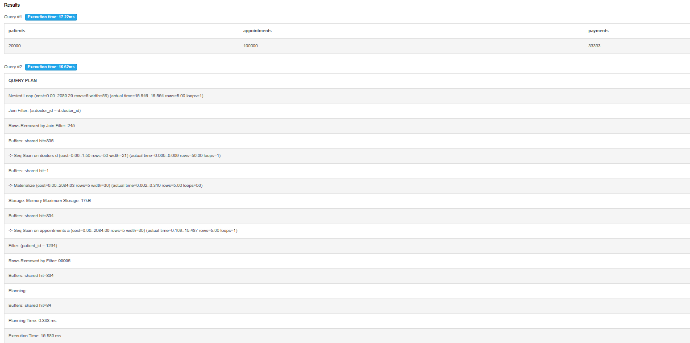
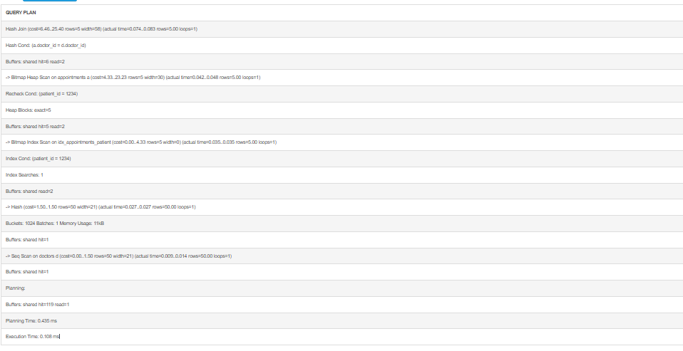

# Portfolio 2: Query Processing and Optimisation

## Case Study
CarePoint Specialist Hospital, Lagos (simulated), the same database as Portfolio 1.

## Environment
- **Database:** PostgreSQL 18, run online using DB Fiddle (db-fiddle.com)
- **Sample data:** 10 departments, 50 doctors, 20,000 patients, 100,000 appointments and 33,333 payments, generated with `generate_series()`

## Query Tested
A receptionist retrieves the appointment history of one patient (patient_id = 1234):

```sql
EXPLAIN ANALYZE
SELECT a.appt_id, a.appt_date, a.appt_time,
       d.first_name || ' ' || d.last_name AS doctor, a.status
FROM appointments a
JOIN doctors d ON d.doctor_id = a.doctor_id
WHERE a.patient_id = 1234;
```

## Before Indexing



PostgreSQL used a **Sequential Scan** on the appointments table. It read all 100,000 rows
and removed 99,995 of them to find only 5 matching appointments.
**Execution time: 15.589 ms**

## Optimisation: Adding an Index

```sql
CREATE INDEX idx_appointments_patient ON appointments(patient_id);
```

PostgreSQL does not automatically index foreign key columns, so `patient_id`
had no index even though it is searched often.

## After Indexing



PostgreSQL now uses a **Bitmap Index Scan on idx_appointments_patient**. It goes directly
to the 5 matching rows instead of scanning the whole table.
**Execution time: 0.108 ms**

## Performance Analysis

| Measure | Before index | After index |
|---|---|---|
| Scan method | Sequential Scan | Bitmap Index Scan |
| Rows examined | 100,000 | 5 |
| Execution time | 15.589 ms | 0.108 ms |

The index made the query about **144 times faster**. In a real hospital, receptionists
and doctors look up patient history many times a day, so this improvement matters
as data grows.

**Trade-off:** Indexes use extra storage and slightly slow down INSERT and UPDATE
operations, because the index must also be updated. For this reason, indexes should be
added only on columns that are searched frequently, such as `patient_id`.
