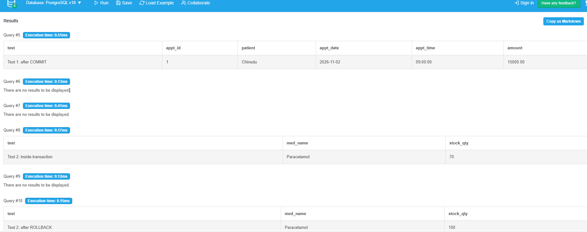
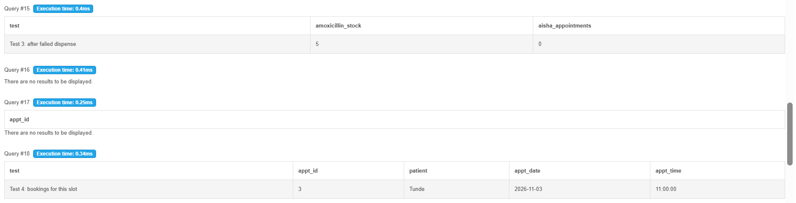
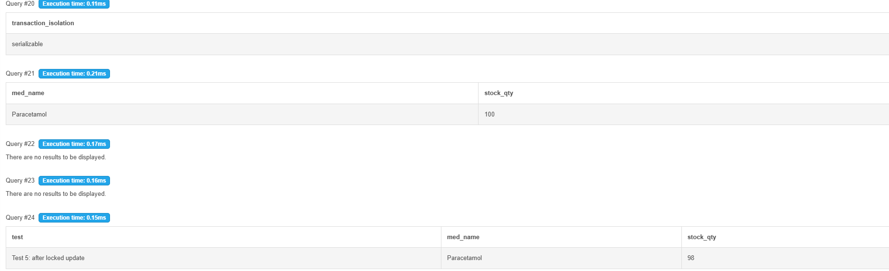

# Portfolio 3: Transactions and Concurrency

## Case Study
CarePoint Specialist Hospital, Lagos (simulated), the same database as Portfolios 1 and 2.

## Environment
- **Database:** PostgreSQL 18, run online using DB Fiddle (db-fiddle.com)
- **Tables used:** departments, doctors, patients, appointments, medications, payments
- **Sample data:** 2 doctors, 3 patients, Paracetamol (100 in stock), Amoxicillin (5 in stock)

## Why Transactions Matter in a Hospital
A transaction groups several operations so they succeed or fail **together** (ACID:
Atomicity, Consistency, Isolation, Durability). In a hospital, a booking without its
payment, or a prescription dispensed without reducing stock, would leave the records wrong.

---

## Test 1: COMMIT (book an appointment and record payment together)

```sql
BEGIN;
INSERT INTO appointments (patient_id, doctor_id, appt_date, appt_time)
VALUES (1, 1, '2026-11-02', '09:00');
INSERT INTO payments (appt_id, amount, method)
VALUES (currval('appointments_appt_id_seq'), 15000, 'Card');
COMMIT;
```

**Result:** Chinedu's appointment (ID 1) and his ₦15,000 card payment were both saved
permanently. This demonstrates **Atomicity** and **Durability**.

## Test 2: ROLLBACK (cancel a mistaken stock update)

```sql
BEGIN;
UPDATE medications SET stock_qty = stock_qty - 30 WHERE med_name = 'Paracetamol';
-- stock shows 70 inside the transaction
ROLLBACK;
-- stock returns to 100
```

**Result:** Inside the transaction, Paracetamol stock dropped to 70. After ROLLBACK
it returned to 100, so the mistake was undone completely.



---

## Test 3: Failed Dispense (whole transaction cancelled)

A doctor prescribes 10 Amoxicillin for Aisha, but only 5 are in stock.

```sql
BEGIN;
INSERT INTO appointments (patient_id, doctor_id, appt_date, appt_time)
VALUES (2, 2, '2026-11-02', '10:00');
UPDATE medications SET stock_qty = stock_qty - 10
WHERE med_name = 'Amoxicillin' AND stock_qty >= 10
RETURNING med_name, stock_qty;   -- returns 0 rows: not enough stock
ROLLBACK;
```

**Result:** Stock stayed at 5 and Aisha's appointment count is 0. The appointment was
cancelled together with the failed dispense, so nothing was half-saved. The table's
`CHECK (stock_qty >= 0)` constraint also guarantees stock can never go negative.

## Test 4: Concurrency Issue (double-booking a doctor)

Two receptionists try to book **Dr Adaeze Okafor** for the **same date and time**.

| Time | Receptionist A | Receptionist B |
|---|---|---|
| 1 | Books Tunde: 3 Nov, 11:00 ✅ | |
| 2 | | Tries to book Aisha: 3 Nov, 11:00 |
| 3 | | Blocked by the UNIQUE constraint ❌ |

```sql
-- Receptionist A
INSERT INTO appointments (patient_id, doctor_id, appt_date, appt_time)
VALUES (3, 1, '2026-11-03', '11:00');

-- Receptionist B (same doctor, date and time)
INSERT INTO appointments (patient_id, doctor_id, appt_date, appt_time)
VALUES (2, 1, '2026-11-03', '11:00')
ON CONFLICT (doctor_id, appt_date, appt_time) DO NOTHING
RETURNING appt_id;   -- returns nothing: booking rejected
```

**Control mechanism:** The `UNIQUE (doctor_id, appt_date, appt_time)` constraint from
Portfolio 1. Even if both receptionists click "Book" at the same moment, PostgreSQL's unique
index lets only one booking win. **Result:** only Tunde holds the 11:00 slot.



---

## Test 5: Isolation Level and Row Locking

```sql
BEGIN ISOLATION LEVEL SERIALIZABLE;
SHOW transaction_isolation;   -- serializable
SELECT med_name, stock_qty FROM medications
WHERE med_name = 'Paracetamol' FOR UPDATE;   -- locks the row
UPDATE medications SET stock_qty = stock_qty - 2 WHERE med_name = 'Paracetamol';
COMMIT;
```

**Result:** The transaction ran at **SERIALIZABLE**, the strictest isolation level.
`SELECT ... FOR UPDATE` locked the Paracetamol row, so if two pharmacists dispense at the
same time, the second must wait until the first commits. This prevents a **lost update**
(both reading 100 and both writing 98, when the correct answer is 96).
**Final stock: 98.**



---

## Summary

| Concept | How it was demonstrated |
|---|---|
| COMMIT | Test 1: appointment + payment saved together |
| ROLLBACK | Tests 2 and 3: mistakes and failures fully undone |
| Isolation | Test 5: SERIALIZABLE isolation level |
| Concurrency issue | Test 4: double-booking attempt |
| Control mechanisms | UNIQUE constraint, CHECK constraint, row lock (FOR UPDATE) |

**Note:** DB Fiddle runs in a single session, so the two receptionists and two pharmacists
were simulated one after the other. In a live system with two real connections, the same
constraints and locks would produce the same protection.
