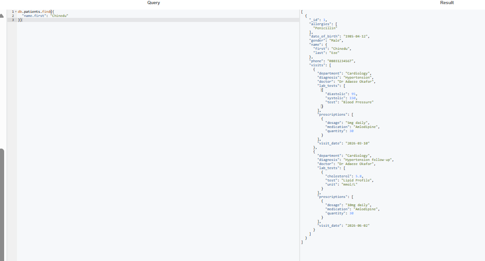
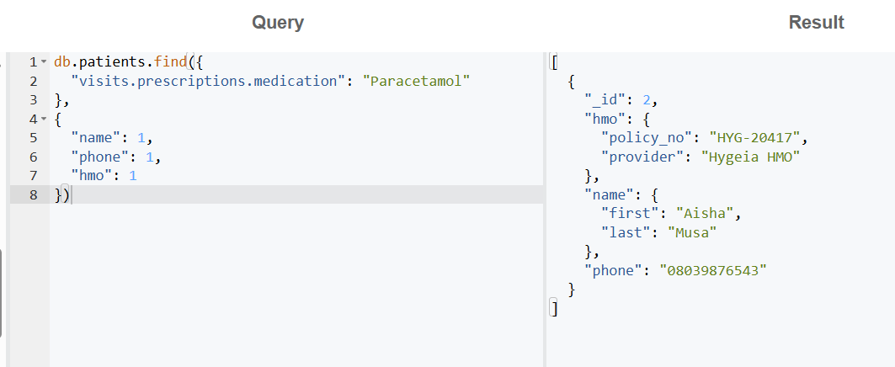
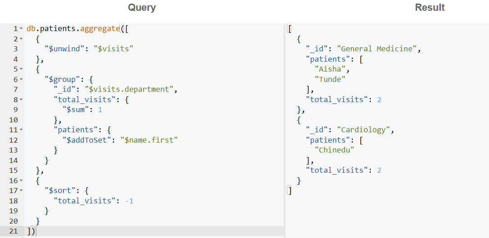

# Portfolio 4: NoSQL and Advanced Data Models

## Case Study
CarePoint Specialist Hospital, Lagos (simulated), the same organisation as Portfolios 1 to 3.

## NoSQL Model Chosen: Document Model (MongoDB)
- **Database:** MongoDB 8.0, run online using Mongo Playground (mongoplayground.net)
- **Collection:** `patients`
- **Data file:** [patients.json](patients.json) (3 patient documents)

## What Was Modelled
In the relational design (Portfolio 1), a patient's history is spread across **6 tables**:
patients, appointments, diagnoses, prescriptions, medications and lab_tests.
In MongoDB, each patient's **complete medical record** is stored as **one document**,
with visits, prescriptions and lab tests **embedded** inside it.

### Example document structure

```json
{
  "_id": 1,
  "name": { "first": "Chinedu", "last": "Eze" },
  "allergies": ["Penicillin"],
  "visits": [
    {
      "visit_date": "2026-03-10",
      "doctor": "Dr Adaeze Okafor",
      "department": "Cardiology",
      "diagnosis": "Hypertension",
      "prescriptions": [ { "medication": "Amlodipine", "dosage": "5mg daily", "quantity": 30 } ],
      "lab_tests": [ { "test": "Blood Pressure", "systolic": 150, "diastolic": 95 } ]
    }
  ]
}
```

### Flexible schema in action
- Only **Chinedu** has an `allergies` field, and only **Aisha** has an `hmo` field.
- Each lab test stores **different fields**: Blood Pressure uses `systolic`/`diastolic`,
  Lipid Profile uses `cholesterol`, and Malaria Parasite uses `result`/`parasite_density`.

In SQL, this would need many empty (NULL) columns or extra tables. In MongoDB, each document
simply holds the fields it needs.

---

## Query 1: Retrieve a patient's full medical history

```javascript
db.patients.find({ "name.first": "Chinedu" })
```

**Result:** Chinedu's details, allergies, both Cardiology visits, prescriptions and lab tests
returned in **one read**, with no joins. In SQL this needs joins across 5 to 6 tables.



## Query 2: Search inside nested data

Find patients prescribed Paracetamol, returning only their name, phone and HMO:

```javascript
db.patients.find(
  { "visits.prescriptions.medication": "Paracetamol" },
  { "name": 1, "phone": 1, "hmo": 1 }
)
```

**Result:** Aisha Musa (Hygeia HMO). MongoDB's dot notation searched two levels deep
(visits → prescriptions), and the projection limited the fields returned.



## Query 3: Aggregation (visits per department)

```javascript
db.patients.aggregate([
  { "$unwind": "$visits" },
  { "$group": {
      "_id": "$visits.department",
      "total_visits": { "$sum": 1 },
      "patients": { "$addToSet": "$name.first" }
  } },
  { "$sort": { "total_visits": -1 } }
])
```

**Result:** General Medicine had 2 visits (Aisha, Tunde) and Cardiology had 2 visits
(Chinedu, twice). `$unwind` splits each visit out, then `$group` counts them per department,
like SQL's GROUP BY.



---

## Suitability: Why a Document Model Fits Patient Records

| Factor | Relational (PostgreSQL) | Document (MongoDB) |
|---|---|---|
| Patient history lookup | Many joins | One document, one read |
| Different lab test formats | NULL columns or extra tables | Each test stores its own fields |
| Adding new fields (e.g. HMO) | ALTER TABLE for everyone | Add to only the documents that need it |
| Strict consistency (stock, payments) | Strong (ACID, constraints) | Weaker across documents |

**Conclusion:** A **hybrid approach** suits CarePoint best:
- **PostgreSQL** for appointments, payments and pharmacy stock, where strict consistency,
  constraints and transactions matter (Portfolios 1 to 3).
- **MongoDB** for patient medical records and lab results, which vary in shape, grow over
  time and are mostly read as a whole.
