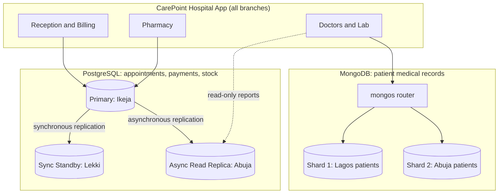

# Portfolio 5: Distributed and Cloud Database Exercise

## Case Study
CarePoint Specialist Hospital (simulated), the same organisation as Portfolios 1 to 4.

## Scenario
CarePoint grows from one hospital into **three branches**:

| Branch | Role |
|---|---|
| **Ikeja, Lagos** | Head office and main data centre |
| **Lekki, Lagos** | Second branch |
| **Abuja (Wuse)** | Third branch |

All branches must see the same patient records, keep working if one server fails, and
handle more patients over time. This portfolio is a **design discussion**: it explains how
the PostgreSQL database (Portfolios 1 to 3) and the MongoDB patient records (Portfolio 4)
would be **distributed** and **deployed in the cloud**.

---

## 1. Proposed Architecture



GitHub draws this diagram automatically from the code above.

---

## 2. Replication (PostgreSQL)

**What it is:** keeping copies of the same database on several servers.

- **Primary (Ikeja):** all writes (bookings, payments, stock updates) go here.
- **Synchronous standby (Lekki):** a payment is only confirmed after Lekki has also saved it.
  If Ikeja fails, **no confirmed payment is lost**.
- **Asynchronous read replica (Abuja):** receives changes a fraction of a second later. It is
  used for reports and look-ups, so they don't slow down the primary.

Example configuration (`postgresql.conf` on the Ikeja primary):

```ini
wal_level = replica
max_wal_senders = 10
synchronous_standby_names = 'lekki_standby'
```

On each standby, the connection to the primary is set with:

```ini
primary_conninfo = 'host=ikeja-primary port=5432 user=replicator application_name=lekki_standby'
```

## 3. Sharding (MongoDB)

**What it is:** splitting data across servers so no single server holds everything.

Patient medical records grow quickly (visits, lab results, scans), so the `patients`
collection is **sharded by branch**. Lagos patients are stored on Shard 1 and Abuja patients
on Shard 2. Each branch reads its own patients from a nearby server, which is faster.

```javascript
sh.enableSharding("carepoint")
sh.shardCollection("carepoint.patients", { "branch": 1, "_id": 1 })

sh.addShardToZone("shard1_lagos", "LAGOS")
sh.addShardToZone("shard2_abuja", "ABUJA")
sh.updateZoneKeyRange("carepoint.patients",
  { "branch": "Lagos", "_id": MinKey }, { "branch": "Lagos", "_id": MaxKey }, "LAGOS")
sh.updateZoneKeyRange("carepoint.patients",
  { "branch": "Abuja", "_id": MinKey }, { "branch": "Abuja", "_id": MaxKey }, "ABUJA")
```

Each shard is itself a **3-member replica set**, so every shard also has copies.

## 4. Availability

| Failure | What happens |
|---|---|
| Ikeja PostgreSQL primary fails | Lekki standby is **promoted** to primary (automatic failover, e.g. with Patroni or a managed cloud service) |
| One MongoDB server fails | The shard's replica set **elects a new primary** within seconds |
| Abuja loses its internet link | Abuja staff can still read recent records from their local replica, and new writes resume when the link returns |
| Whole data centre lost | Restore from daily backups plus continuous WAL archiving to cloud storage |

**Target:** at least **99.9% uptime**, because hospitals run 24/7.

## 5. Consistency (CAP Theorem)

The **CAP theorem** says a distributed system cannot guarantee **C**onsistency, **A**vailability
and **P**artition tolerance all at once during a network failure. CarePoint makes a different
choice for each type of data:

| Data | Priority | Reason |
|---|---|---|
| Payments, pharmacy stock, appointment slots | **Consistency (CP)** | A double-booking or wrong stock figure is unacceptable (the problems from Portfolio 3) |
|
